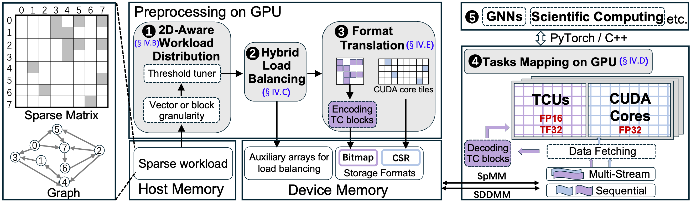

# Libra: Unleashing GPU Heterogeneity for High-Performance Sparse Matrix Multiplication
<!-- + **Cite this project and [paper](https://arxiv.org/abs/2506.22714).**  -->

## Hardware
The NVIDIA H100 with 80 GB memory and RTX4090 GPU with 24 GB memory.

## Software
Ubuntu 20.04.6; Pytorch 2.1.2+cu118; CUDA 11.8; gcc 7.5.0; DGL 2.1.0+cu118; PyG 2.5.0.

## Datasets / Inputs
We select a representative set of 500 sparse matrices from the SuiteSparse collection, which span various sparsity patterns, to evaluate kernel performance.
In addition, we also select classic graph datasets across different application domains such as IGB, Reddit for end-to-end performance evaluation.

## Installation and Deployment
### install C++ compilation dependencies
* apt-get install libnuma-dev

* apt-get install libgoogle-perftools-dev

* apt-get install libboost-all-dev

* apt-get install libgoogle-perftools-dev \\

### install Libra:
* bash ./Libra-source/compile.sh 

## Artifact Execution
### To Reproduce Figure 9:
* bash ./eva100/kernel/spmm/test\_spmm\_h100\_shell.sh 

* python ./eva100/plot/kernel\_spmm/h100\_128/plot\_cuda.py 

* python ./eva100/plot/kernel\_spmm/h100\_128/plot\_tcu.py

### To Reproduce Figure 10: 
* bash ./eva100/kernel/spmm/test\_sddmm\_h100\_shell.sh 

* python ./eva100/plot/kernel\_sddmm/h100\_32/plot\_cuda.py 

* python ./eva100/plot/kernel\_sddmm/h100\_32/plot\_tcu.py

### To Reproduce Table IV: 
* python ./eva100/plot/kernel\_spmm/profile\_all.py

### To Reproduce Table V: 
* ./eva100/plot/ablation

### To Reproduce Figure 11: 
* python ./eva100/plot/ablation/hybird/plot.py

### To Reproduce Figure 12: 
* python ./eva100/plot/ablation/data_access/plot_cc_only_spmm.py
* python ./eva100/plot/ablation/data_access/plot_cc_only_sddmm.py

### To Reproduce Figure 13: 
* python ./eva100/plot/ablation/threshold.py

### To Reproduce Figure 14: 
* python ./eva100/plot/ablation/tcu_utilization/spmm/plot.py
* python ./eva100/plot/ablation/tcu_utilization/sddmm/plot.py

### To Reproduce Figure 15: 
* python ./eva100/plot/ablation/data_access/spmm/plot.py
* python ./eva100/plot/ablation/data_access/sddmm/plot.py

### To Reproduce Figure 16: 
* python ./eva100/plot/ablation/atomic/plot.py
* python ./eva100/plot/ablation/atomic/plot_size.py

### To Reproduce Figure 17: 
* python ./eva100/plot/gnn/plot.py
* python ./eva100/plot/agnn/plot.py

### To Reproduce Figure 18: 
* python ./eva100/plot/ablation/amd/plot_amd_spmm.py
* python ./eva100/plot/ablation/amd/plot_amd_sddmm.py
